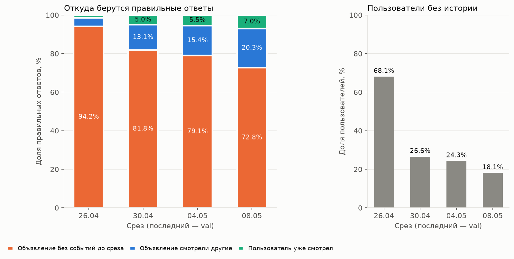
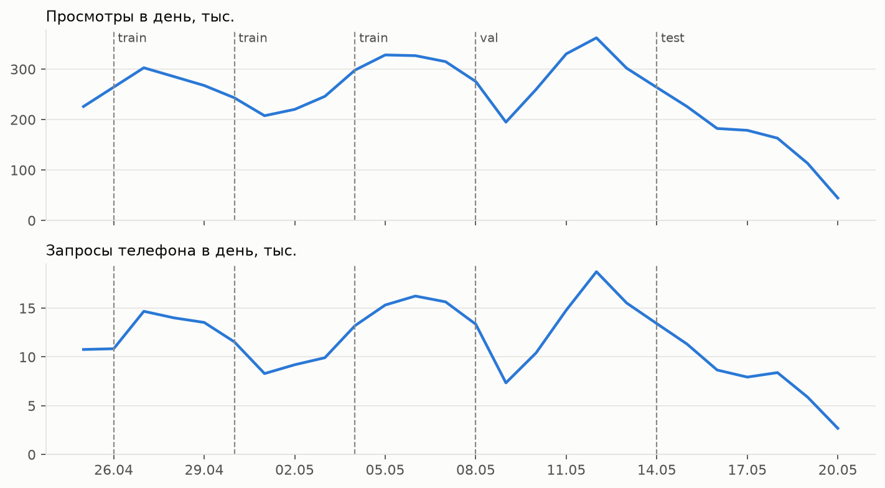
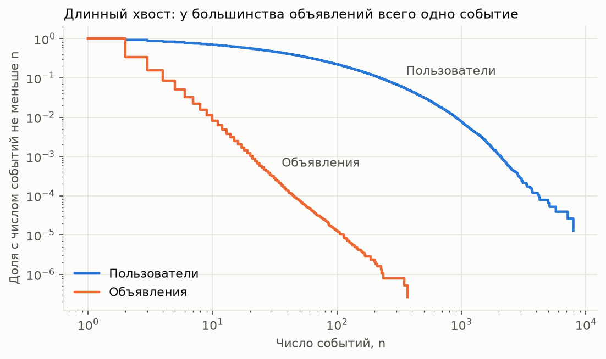
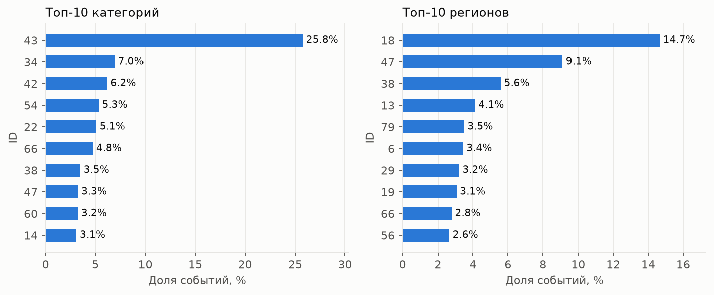

# avito-recsys

Двухэтапная рекомендательная система на реальных данных Avito: кандидатогенерация и ранжирование.

**Задача.** Для каждого пользователя предсказать объявления, которые он посмотрит в ближайшие 4 дня.
Это задача `user-ad-visit` из бенчмарка [RelBench](https://relbench.stanford.edu/datasets/rel-avito),
метрика MAP@k, разбиение по времени.

**Данные.** `rel-avito` собран из соревнования Avito Context Ad Clicks. Основные таблицы:
просмотры объявлений (`VisitStream`), запросы телефона продавца (`PhoneRequestsStream`),
объявления (`AdsInfo`), поиски (`SearchInfo`), пользователи, категории и регионы.

## Быстрый старт

```bash
python -m venv .venv && source .venv/bin/activate
pip install -e ".[dev]"
python scripts/download_data.py
python scripts/eda.py
python scripts/run_baselines.py
python scripts/run_item2item.py
pytest
```

## Что показали данные

События идут с 25 апреля по 20 мая 2015: 6,43 млн просмотров и 0,30 млн запросов телефона.
Цифры и графики ниже воспроизводит `scripts/eda.py`. Срез val — момент 8 мая, используются только события раньше него.



| Показатель на val | Значение |
| --- | --- |
| Ответы по объявлениям без единого события до среза | 72,8% |
| Ответы, которые пользователь уже смотрел | 7,0% |
| Пользователи хотя бы с одним повтором | 41,0% |
| Пользователи без истории | 18,1% |
| Ответы в трёх любимых категориях пользователя | 72,4% |
| Ответы в самом частом регионе пользователя | 78,8% |

Выводы для модели:

- **Главная трудность — холодные объявления.** Методы на совместных просмотрах (item2item, ALS, популярное)
  не могут предложить объявление без истории, поэтому им доступно не больше 27% ответов. Показы в поиске
  почти не помогают: до среза там встречалось только 3,9% холодных ответов. Зато у всех объявлений есть
  заголовок, категория, регион и цена, так что нужны генераторы по содержанию.
- **История пользователя слабее, чем можно ждать.** Повторов всего 7% ответов, это потолок для такого бейзлайна.
- **Длинный хвост.** У 65,5% объявлений всего одно событие, у медианного пользователя 26 событий.
  На верхний 1% объявлений приходится только 7,7% событий, поэтому популярное покрывает мало.
- **Интересы устойчивы.** Категория и регион сильно сужают поиск и подходят для холодных объявлений.
- **Ранний срез train почти бесполезен.** На 26 апреля есть всего один день истории:
  68% пользователей без истории и 94% холодных ответов.
- **Test может отличаться от val.** После 14 мая событий резко меньше: в понедельник 18 мая 163 тыс. просмотров
  против 330 тыс. неделей раньше. Сравнивать val и test напрямую не стоит.







## Бейзлайны

Метрики на val, параметры подобраны там же, test не использовался. Воспроизводит `scripts/run_baselines.py`.

| Генератор | MAP@12 | NDCG@12 | Recall@12 | Recall@50 | Recall@200 |
| --- | --- | --- | --- | --- | --- |
| Популярное за 7 дней | 0,0000 | 0,0001 | 0,0001 | 0,0004 | 0,0007 |
| Популярное в категории, 7 дней | 0,0005 | 0,0010 | 0,0010 | 0,0022 | 0,0056 |
| Популярное в категории и регионе, 7 дней | 0,0055 | 0,0111 | 0,0089 | 0,0183 | 0,0349 |
| История, период полураспада 30 дней | 0,0498 | 0,0831 | 0,0566 | 0,0771 | 0,0878 |
| История, период полураспада 3 дня | 0,0541 | 0,0887 | 0,0581 | 0,0776 | 0,0878 |
| История + категория и регион + категория + популярное | 0,0542 | 0,0888 | 0,0582 | 0,0787 | 0,0937 |

- **История даёт почти всё качество.** Затухание поднимает MAP@12 на 9% и не меняет Recall@200: оно только
  переставляет те же объявления. Recall@200 упирается в потолок 9%, посчитанный в EDA.
- **Глобальное популярное не работает.** Самое популярное объявление за неделю (224 события) попало в ответы только
  одного пользователя val из 29 979. Даже оракул, заранее знающий 12 самых частых ответов val, набирает
  MAP@12 = 0,00025.
- **Регион важнее, чем ожидалось.** Он поднимает популярное в категории примерно в 10 раз: объявления локальны.
- **Склейка почти не меняет MAP@12.** История занимает первые места, а дозаполнение прибавляет только Recall при большом K.
- **Пользователи без истории остаются без качества.** Это 18% val, история для остальных даёт MAP@12 = 0,066.
  Поиск не спасает: запросы до среза есть только у 4% таких пользователей.

## Item2item

Два объявления похожи, если их смотрели одни и те же пользователи (косинус по совместным просмотрам).
Выдача не содержит уже просмотренного: это покрывает история. Метрики на val, воспроизводит `scripts/run_item2item.py`.

| Генератор | MAP@12 | Recall@12 | Recall@50 | Recall@100 | Recall@200 |
| --- | --- | --- | --- | --- | --- |
| Item2item, 50 соседей | 0,0008 | 0,0012 | 0,0032 | 0,0048 | 0,0060 |
| Item2item, 1000 соседей, shrink 20 | 0,0016 | 0,0017 | 0,0043 | 0,0063 | 0,0087 |
| История | 0,0541 | 0,0581 | 0,0776 | 0,0842 | 0,0878 |
| История + item2item | 0,0542 | 0,0582 | 0,0791 | 0,0876 | 0,0941 |
| История + категория и регион | 0,0542 | 0,0582 | 0,0787 | 0,0867 | 0,0937 |
| История + item2item + категория и регион | 0,0542 | 0,0582 | 0,0793 | 0,0883 | **0,0959** |

- **Item2item слаб.** Ему доступно около 20% ответов (объявления с историей, которые пользователь не видел),
  а находит он меньше 1%. У 65,5% объявлений всего одно событие, совместных просмотров почти нет.
- **Польза есть только как дополнение.** Item2item и популярное в регионе прибавляют Recall@200 с 8,8% до 9,6%,
  причём item2item надо ставить раньше: в обратном порядке первые 200 мест занимает популярное.
- **MAP@12 не меняется.** Первые 12 мест почти всегда занимает история. Поднять его должен ранжировщик.
- **Предел истории.** 50 объявлений на пользователя дают столько же, сколько 100 (Recall@200 0,0060 и 0,0058),
  но втрое быстрее: 23 с против 67 с.

## План

- [x] Загрузка данных и таблица взаимодействий
- [x] Метрики и EDA
- [x] Бейзлайны: история пользователя, популярное
- [ ] Кандидатогенераторы: ~~item2item~~ готов, ALS, эмбеддинги заголовков
- [ ] Ранжирование на CatBoost
- [ ] Сервис FastAPI + gRPC, Airflow DAG, Docker
